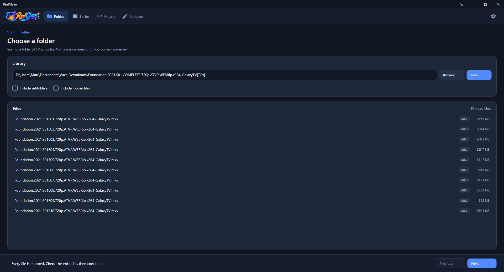
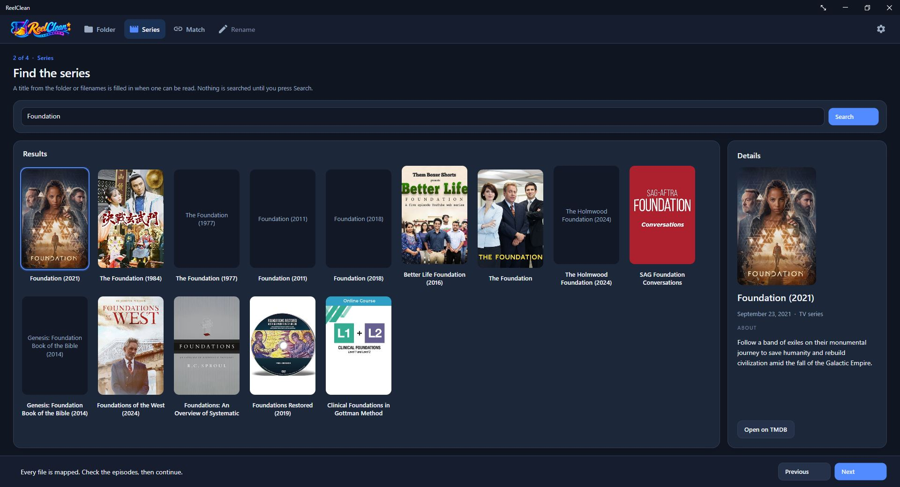
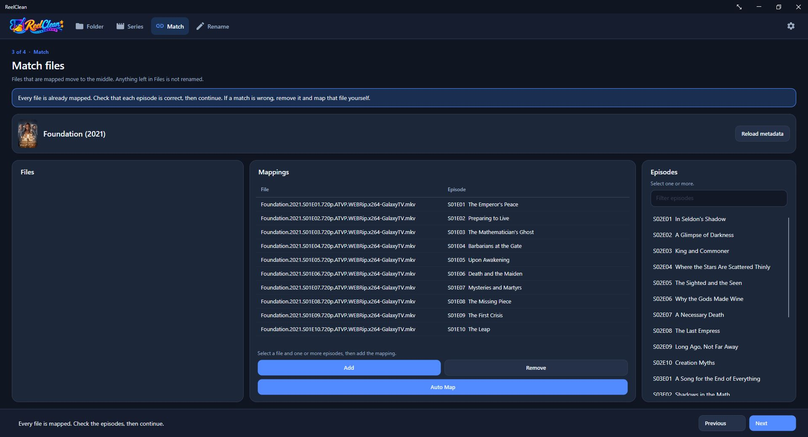
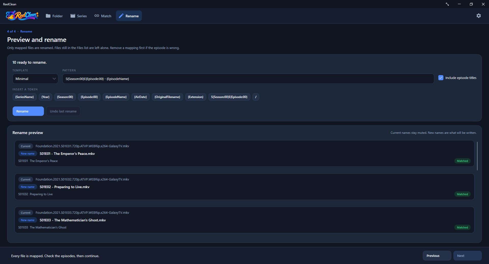

ReelClean is a cross-platform desktop app for renaming one folder of TV shows at a time. It reads episode numbers from filenames, matches them to [TMDB](https://www.themoviedb.org/), shows a rename preview, and only then renames files.

This product uses the TMDB API but is not endorsed or certified by TMDB.

## Screenshots

### Step 1: Select Folder

### Step 2: Select Series

### Step 3: Match

### Step 4: Rename

## TMDB key

Create a v3 API key at themoviedb.org, open Settings from the top bar, paste the key in, and click Save. Save writes `%AppData%\ReelClean\settings.json` on Windows, and the equivalent application-data folder on macOS and Linux.

The rename template, including a custom pattern, is saved in that same user-profile file when you change it.

The client calls `https://api.themoviedb.org/3/` with the `api_key` query parameter.

## Downloads

Published releases are on the [GitHub releases page](https://github.com/gordon-matt/ReelClean/releases).

Unzip the download and run `ReelClean` (`ReelClean.exe` on Windows). macOS may warn that the app is from an unidentified developer until it is code-signed and notarized. Linux may ask for system libraries such as fontconfig, depending on the distribution.

Scanning does not rename anything. High-confidence matches can be renamed after you confirm the preview. Medium, low, and unmatched files have to be assigned or ignored first. Renames stay inside the file's current folder. A history file under the ReelClean application-data folder supports undo when the new files are still in place and the original paths are free.

## Not in this version

Movies, subtitles, anime numbering, multi-series scans, and installers are out of scope.

## Support

If you find this project useful, consider supporting its development.

  &nbsp;&nbsp;&nbsp;
  

  Prefer using your phone? Scan the QR code:

  

